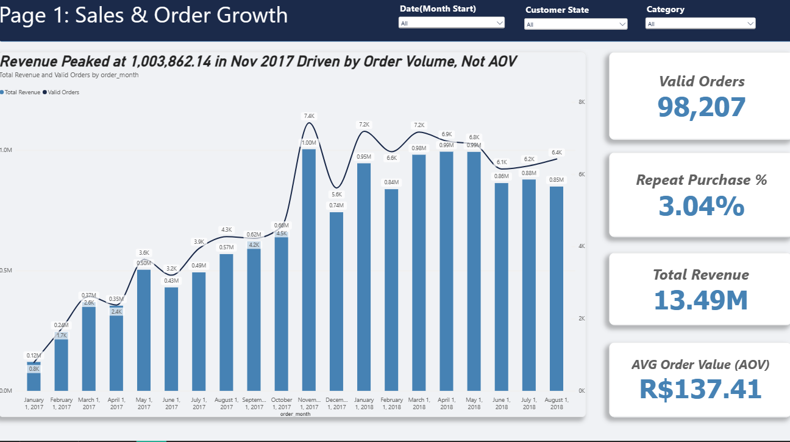
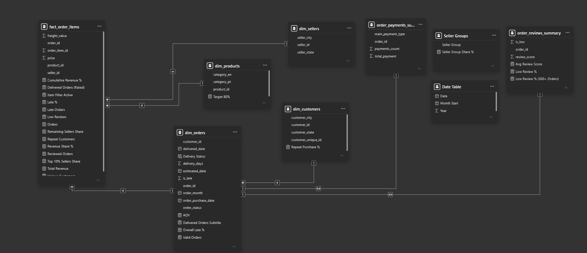
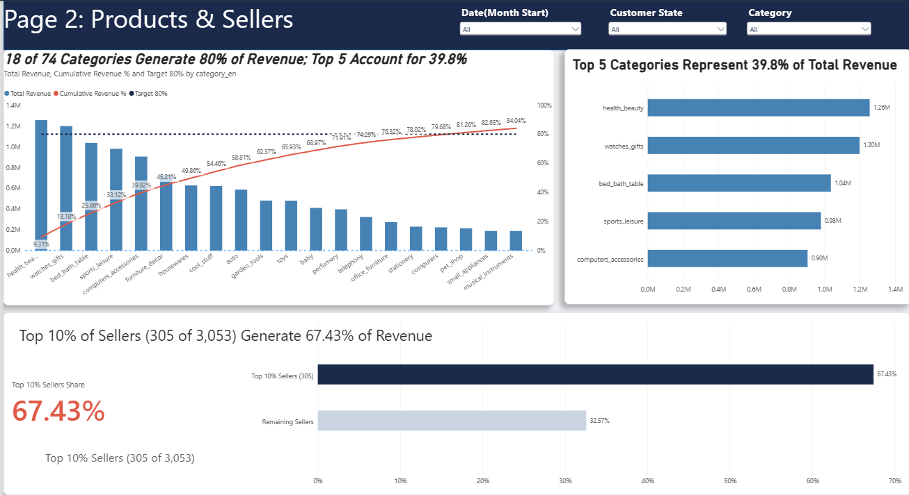
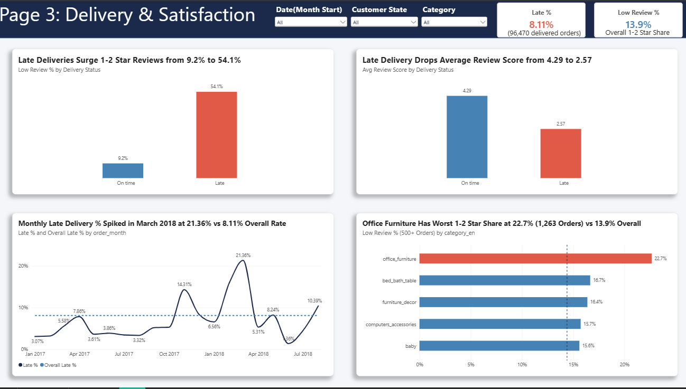

# Olist Brazilian E-Commerce Analytics: Revenue Drivers, Seller Concentration & Delivery Impact on Reviews



## Executive Summary & Core Finding

**Core business question:** _What drives revenue growth on the Olist marketplace, and how are late deliveries associated with customer satisfaction?_

An end-to-end analysis of **99,441 orders** (**98,207 valid orders**, **R$ 13.49M** in product revenue, 2016-2018) using **Python (`pandas`, `matplotlib`)**, **PostgreSQL**, and **Power BI** shows:

- **Growth came from order volume, not basket size.** Between Jan-Aug 2017 and Jan-Aug 2018, revenue grew about **138%** and orders about **137%**, while the Average Order Value stayed flat (**R$ 137.41** overall).
- **Late delivery goes with bad reviews.** **8.11%** of **96,470** delivered orders arrived late (peak: **21.36%** in **March 2018**). Late orders average **2.57 stars** vs **4.29** for on-time orders, and **54.1%** of them get 1-2 stars vs **9.2%**. This is an association, not proven causation.
- **Revenue is concentrated.** The top 5 categories generate **39.8%** of revenue, and the top 10% of sellers generate **67.43%**.
- **Repeat purchases are rare.** Only **3.04%** of **94,990** unique customers ordered more than once.

| Metric Category           | Key Performance Indicator (KPI)                |                   Verified Value | Business & Analytical Context                                                                                         |
| :------------------------ | :--------------------------------------------- | -------------------------------: | :-------------------------------------------------------------------------------------------------------------------- |
| **Order Volume**          | Total Raw Orders / Valid Orders                |              **99,441 / 98,207** | Excludes **1,234** `canceled` (625) and `unavailable` (609) orders                                                    |
| **Revenue & Basket**      | Total Product Revenue / AOV                    | **R$ 13,494,400.74 / R$ 137.41** | `SUM(price)` across **112,101** valid items; excludes `freight_value`                                                 |
| **Seasonal Peak**         | Highest Monthly Revenue                        |              **R$ 1,003,862.14** | Recorded in **November 2017** (**7,421** valid orders; possibly seasonal promotions such as Black Friday, not tested) |
| **Customer Retention**    | Repeat Purchase Rate                           |                        **3.04%** | **2,888** repeat buyers out of **94,990** valid `customer_unique_id`s                                                 |
| **Category Pareto**       | Top 5 / Top 18 Categories Share                |                **39.8% / 80.0%** | **18 of 74** product categories generate **80%** of total marketplace revenue                                         |
| **Seller Pareto**         | Top 10% Active Sellers Share                   |                       **67.43%** | **305 of 3,053** active sellers capture over two-thirds of product revenue                                            |
| **Logistics SLA**         | Overall Late Delivery Rate                     |                        **8.11%** | **7,826** late orders out of **96,470** delivered orders (March 2018 peak: **21.36%**)                                |
| **Satisfaction Gap**      | Average Review Score (On-Time vs. Late)        |            **4.29 ★ vs. 2.57 ★** | **-1.72 ★** drop when delivery misses the estimated delivery date                                                     |
| **Dissatisfaction Surge** | 1–2 Star Review Share (On-Time vs. Late)       |               **9.2% vs. 54.1%** | Overall low-review baseline is **14.4%** (**13.9%** in Power BI model view)                                           |
| **Category Quality Risk** | Worst Category by 1–2 Star Share (≥500 Orders) |   **22.6% (`office_furniture`)** | **22.7%** in Power BI item-filtered view across **1,263** reviewed orders                                             |

## Business Problem & Objectives

Olist operates as a decentralized Brazilian e-commerce marketplace connecting **3,095 registered small-to-medium sellers** across **23 states** with buyers across **27 states**. Because Olist relies on third-party carriers and dispersed merchants, leadership faces four structural questions:

1. **Revenue Quality & Growth Mechanics:** Is marketplace top-line expansion driven by customers spending more per basket (higher AOV) or strictly by new customer acquisition volume?
2. **Catalog & Merchant Concentration Risk:** How heavily does Olist depend on a narrow subset of product categories and top-tier sellers, and where are the geographic supply bottlenecks?
3. **Payment & Financial Integrity:** Do customer payment records (`order_payments`) reconcile accurately against item prices and shipping charges (`order_items`)?
4. **Delivery & Customer Satisfaction:** How strongly are late deliveries and specific product categories associated with negative customer reviews (1–2 stars)?

## Dataset & Scope

- **Source:** [Brazilian E-Commerce Public Dataset by Olist (Kaggle)](https://www.kaggle.com/datasets/olistbr/brazilian-ecommerce) _(Raw CSV files are excluded from this repository via `.gitignore` to keep the repository lightweight)._
- **Timeframe Analyzed:** Full dataset spans **September 2016 to October 2018** (**99,441** orders). Monthly trend analyses are scoped to **January 2017 – August 2018** (**20 complete months**) to prevent boundary distortion from incomplete edge months (Sep–Dec 2016 had only 329 total orders; Sep–Oct 2018 had only 20 orders).
- **Core Relational Tables:** `orders.csv` (99,441 rows), `order_items.csv` (112,650 rows), `products.csv` (32,951 rows), `product_category_name_translation.csv` (71 rows), `sellers.csv` (3,095 rows), `customers.csv` (99,441 rows / 96,096 unique buyers), `order_payments.csv` (103,886 rows), and `order_reviews.csv` (99,224 rows).

## Technical Approach & Data Engineering Decisions

The project follows a three-layer analytics workflow: **Python (`olist_analysis.ipynb`)** for programmatic data auditing, cleaning, and statistical validation; **PostgreSQL (`queries.sql`)** for relational verification; and **Power BI (`dashboard/olist_dashboard.pbix`)** for star-schema data modeling, DAX measures, and interactive executive reporting.

| Analytical Decision Area                  | Problem Identified in Raw Data                                                                                                                                                                                             | Engineering Rule & Implementation                                                                                                                                                                                       | Impact on Metric Accuracy                                                                                                       |
| :---------------------------------------- | :------------------------------------------------------------------------------------------------------------------------------------------------------------------------------------------------------------------------- | :---------------------------------------------------------------------------------------------------------------------------------------------------------------------------------------------------------------------- | :------------------------------------------------------------------------------------------------------------------------------ |
| **1. Revenue Definition**                 | `order_items` includes both `price` and `freight_value`, while `order_payments` includes shipping and installment interest.                                                                                                | Defined **Product Revenue = `SUM(price)`** from `order_items`, excluding `freight_value` (shipping pass-through cost, mean **R$ 19.99**).                                                                               | Prevents inflating merchandise revenue by **R$ 2.25M** in carrier freight charges.                                              |
| **2. Valid Order Scope**                  | **775** orders in `orders.csv` have no matching items in `order_items.csv` (603 `unavailable`, 164 `canceled`, 5 `created`, 2 `invoiced`, 1 `shipped`).                                                                    | Filtered commercial metrics to **Valid Orders (`98,207`)** by excluding `canceled` (625) and `unavailable` (609). Restricted delivery/SLA metrics strictly to `delivered` orders with non-null timestamps (**96,470**). | Eliminates unfulfilled orders from revenue while keeping in-transit valid orders separate from completed delivery SLAs.         |
| **3. Customer Identity**                  | `customer_id` has **99,441** unique values (one per order), masking repeat buyers.                                                                                                                                         | Grouped all retention and geographic customer metrics by **`customer_unique_id`** (**96,096** total; **94,990** with valid orders).                                                                                     | Correctly identifies the **2,888** repeat customers (**3.04%** repeat rate) instead of falsely reporting 0%.                    |
| **4. Join Cardinality Validation**        | Joining multi-item orders (`112,650` items) directly to multi-row payments (`103,886` rows) or reviews (`99,224` rows) causes Cartesian fan-out.                                                                           | Enforced `validate="one_to_many"` and `validate="many_to_one"` in `pandas.merge()`, and pre-aggregated payments and reviews to `1:1` order-level summaries before joining.                                              | Prevents silent row multiplication and revenue inflation across multi-item orders (up to **21** items per order).               |
| **5. Review Deduplication**               | **547** orders had multiple review entries (up to **3** reviews per `order_id`), totaling **99,224** rows for **98,673** reviewed orders.                                                                                  | Sorted `order_reviews` by `review_answer_timestamp` and retained only the latest review per order (`drop_duplicates("order_id", keep="last")`).                                                                         | Ensures exactly one customer satisfaction score per order across the **95,824** delivered reviewed orders.                      |
| **6. Missing Categories**                 | **610** products (**1.85%**, or **1,603** order items) had `NULL` category names; **24** items in `pc_gamer` (9) and `portateis_cozinha...` (15) lacked English translations (counted across all **112,650** items).       | Labeled `NULL` categories as `"unknown"` and fell back to Portuguese names for untranslated categories in the dashboard; excluded these **1,627** items (**1.36%** of revenue) from the Python category ranking.        | Preserves 100% of revenue in grand totals while preventing unlabeled items from skewing category benchmarks.                    |
| **7. Sample Size Threshold**              | Tiny categories with <50 orders exhibit extreme average prices and volatile complaint rates.                                                                                                                               | Enforced a minimum threshold of **`>= 500` orders** when ranking highest-priced categories and worst-reviewed categories.                                                                                               | Ensures statistical reliability when flagging `office_furniture` (**22.6%** low reviews across **1,263** orders).               |
| **8. Power BI Star Schema & DAX Context** | Single-direction `1:*` relationships (`dim_products -> fact_order_items` and `dim_orders -> fact_order_items`) prevent category slicers from filtering `order_reviews_summary`, and DAX evaluates `BLANK() = 0` as `TRUE`. | Used `ISBLANK(dim_orders[is_late])` before evaluating `0/1` status, and applied `CROSSFILTER(..., Both)` and `TREATAS(VALUES(fact_order_items[order_id]), ...)` inside DAX measures.                                    | Keeps the data model fast and unambiguous while allowing product/seller slicers to dynamically filter review and delivery KPIs. |

## Data Model Architecture (Power BI Star Schema)

The Power BI model (`dashboard/olist_dashboard.pbix`) structures the cleaned tables into a star-schema architecture centered on `fact_order_items`, with `dim_orders` acting as the header bridge to order-level summaries (`order_payments_summary` and `order_reviews_summary`) and a dedicated `Date Table` (`Date`, `Year`, `Month Start`).



## Key Analytical Findings

### 1. Volume-Driven Growth & the November 2017 Peak

- **138% YoY Expansion Driven by Order Count:** Monthly valid revenue climbed more than 8-fold during 2017, rising from **R$ 120,098.27** (**787** orders) in January 2017 to an all-time peak of **R$ 1,003,862.14** (**7,421** orders) in **November 2017** (possibly seasonal promotions such as Black Friday, a hypothesis not tested here), before pulling back to **R$ 742,183.79** (**5,618** orders) in December 2017.
- **2018 Stabilization & Flat AOV:** Throughout January–August 2018, monthly revenue plateaued between **R$ 837,895.43** (Feb 2018) and **R$ 993,592.98** (Apr 2018). Because monthly AOV remained tightly bounded between **R$ 124.76** and **R$ 152.60** (averaging **R$ 136.55** in Jan–Aug 2017 vs. **R$ 137.14** in Jan–Aug 2018), revenue growth came mainly from more orders (**+137%**) rather than larger baskets (**1.14** items/order on average; **90.1%** of orders contain just 1 item).

### 2. Low Repeat Purchase Rate (3.04%)

- Out of **94,990** unique customers with valid orders, **92,102 (96.96%)** purchased only once, and just **2,888 (3.04%)** ever returned for a repeat purchase.
- Because few customers return, the 2018 order run-rate (about 6,100–7,200 orders per month) depends mostly on first-time buyers.

### 3. Product Category Pareto & Price-Volume Divergence

- **80/20 Concentration:** Just **5 categories** generate **39.8%** of total revenue, and **18 of 74 categories (24.3%)** generate **80.0%** of total revenue:
  1. `health_beauty`: **R$ 1,255,695.13** (**9.31%** revenue share | **8,800** orders | **R$ 130.34** avg item price)
  2. `watches_gifts`: **R$ 1,198,185.21** (**8.88%** revenue share | **5,604** orders | **R$ 200.70** avg item price)
  3. `bed_bath_table`: **R$ 1,035,964.06** (**7.68%** revenue share | **9,399** orders | **R$ 93.36** avg item price)
  4. `sports_leisure`: **R$ 979,740.92** (**7.26%** revenue share | **7,673** orders | **R$ 114.06** avg item price)
  5. `computers_accessories`: **R$ 904,322.02** (**6.70%** revenue share | **6,654** orders | **R$ 116.22** avg item price)
- **Volume vs. Ticket Size Divergence:** Order volume rankings do not mirror revenue rankings. `bed_bath_table` ranks **#1 in order count (9,399)** but **#3 in revenue** due to a lower average item price (**R$ 93.36**), whereas `watches_gifts` ranks **#7 in order count (5,604)** but **#2 in revenue** thanks to a high average ticket (**R$ 200.70**). High-ticket categories (≥500 orders) are led by `musical_instruments` (**R$ 280.70**) and `small_appliances` (**R$ 280.04**), whereas high-volume `telephony` (**4,183** orders) averages only **R$ 71.20** per item (**R$ 322,342.64** revenue).

### 4. Seller & Geographic Concentration (São Paulo Hub)

- **Merchant Pareto:** The **top 10% of active sellers (305 of 3,053)** generate **67.43%** of total marketplace revenue, leaving the remaining **2,748 sellers (90%)** with just **32.57%**.
- **Southeast Supply Concentration:** **59.7%** of all registered sellers (**1,849**) are located in **São Paulo (`SP`)**, generating **64.4%** of total revenue (**R$ 8,687,740.35**), followed by Paraná (`PR`, **11.3%** of sellers / **9.3%** of revenue) and Minas Gerais (`MG`, **7.9%** of sellers / **7.4%** of revenue).
- **Demand vs. Supply Imbalance:** While `SP` represents **41.9%** of unique buyers (**40,302**), states like Rio de Janeiro (`RJ`) represent **12.9%** of buyers (**12,384**) but only **5.5%** of sellers (**171**), and Bahia (`BA`) represents **3.4%** of buyers (**3,277**) vs. **0.6%** of sellers (**19**), which likely means long-distance shipping from `SP` to these states (not measured here).

### 5. Payment Behavior & Reconciliation Audit

- **Credit Card & Installment Dominance:** Credit cards account for **73.9%** of payment transactions and **78.3%** of total payment value (**R$ 12,542,084.19**), followed by **Boleto Bancário** (**19.0%** of transactions / **17.9%** of value = **R$ 2,869,361.27**), **Vouchers** (**5.6%** of transactions / **2.4%** of value), and **Debit Cards** (**1.5%** of transactions / **1.4%** of value). Exactly **50.6%** of transactions are paid in a single installment, while **49.4%** utilize multi-month credit installments (up to 24 installments, with major clusters at 2–10 installments).
- **Order-Payment Reconciliation:** Across **98,665** orders present in both `order_items` and `order_payments` (only **1** delivered order with items lacked a payment record), **99.69%** reconciled within R$ 0.01. Exactly **303 orders (0.31%)** showed a discrepancy `> R$ 0.01` between `payment_value` and `price + freight_value`, with **87.1%** of those cases showing `payment_value > expected_total` (possible causes such as installment fees or rounding were not tested).

### 6. Delivery Delays Are Strongly Associated with Negative Reviews

- **Delivery Duration & Delay Rate:** Delivered orders take an average of **12.56 days** (median **10.22 days**, IQR **6.77 – 15.72 days**, max **209.63 days**). Overall, **8.11%** (**7,826** of **96,470** delivered orders) arrived past their estimated delivery date, with monthly delay rates spiking to **21.36%** (**21.4%**) in **March 2018** (the cause is not identified in this data).
- **The Satisfaction Cliff (Correlation, Not Causation):** Across **95,824** delivered orders with customer reviews:
  - **On-Time Deliveries (`88,163` orders):** Achieved a **4.29 ★** average rating, with only **9.2%** receiving 1–2 stars.
  - **Late Deliveries (`7,661` orders):** Plunged to a **2.57 ★** average rating (**-1.72 ★** penalty), with **54.1%** receiving 1–2 stars.
  - _(Note: While this demonstrates a powerful statistical association, observational order data alone cannot prove strict causality without controlling for carrier damage or regional infrastructure shocks)._

### 7. Furniture & Home Categories Suffer the Highest Dissatisfaction

- Among categories with at least **500 reviewed orders** (compared against an overall low-review baseline of **14.4%** in Python / **13.9%** across all model reviews):
  1. `office_furniture`: **22.6%** low-review share (**22.7%** in Power BI item-filtered view | **1,263** orders)
  2. `bed_bath_table`: **16.8%** low-review share (**16.7%** in Power BI | **9,313** orders)
  3. `furniture_decor`: **16.7%** low-review share (**16.4%** in Power BI | **6,398** orders)
  4. `computers_accessories`: **16.1%** low-review share (**15.7%** in Power BI | **6,649** orders)
  5. `baby`: **16.0%** low-review share (**15.6%** in Power BI | **2,861** orders)
- Furniture and home categories dominate the top of the list. Possible reasons (shipping damage, split deliveries, size mismatches) were **not tested** in this analysis.

## Interactive Power BI Dashboard Gallery

The 3-page Power BI report (`dashboard/olist_dashboard.pbix`) uses native visuals, synchronized cross-page slicers (`Date`, `Customer State`, `Category`), and conclusion-first action titles:

| Dashboard Page                      | Primary Business Question Answered                                                                  | Visual Preview                                                         |
| :---------------------------------- | :-------------------------------------------------------------------------------------------------- | :--------------------------------------------------------------------- |
| **Page 1: Sales & Order Growth**    | _How did revenue scale from Jan 2017 to Aug 2018, and was growth driven by order volume or AOV?_    |                                  |
| **Page 2: Products & Sellers**      | _Which product categories and seller tiers drive 80% and 67.43% of marketplace revenue?_            |            |
| **Page 3: Delivery & Satisfaction** | _How severely do late deliveries and specific product categories impact 1–2 star customer reviews?_ |  |

## Strategic Recommendations

| Priority                                 | Action                                                                                                                                                                                    | Owner                             | Expected Impact                                                                                                              |
| :--------------------------------------- | :---------------------------------------------------------------------------------------------------------------------------------------------------------------------------------------- | :-------------------------------- | :--------------------------------------------------------------------------------------------------------------------------- |
| **1. Find where delays come from**       | Measure the late rate **per seller and per destination state** (not done in this analysis), then start with the worst. After that, review the estimated delivery date for those routes.   | **Logistics & Operations**        | Locates the source of the **8.11%** late rate. Late orders carry the **54.1%** 1-2 star share.                               |
| **2. Review the furniture categories**   | Read the review comments of `office_furniture` (**22.6%** low reviews, **1,263** orders) and `furniture_decor` (**16.7%**, **6,398** orders) to find the reason (packaging, size, delay). | **Quality & Category Management** | Bring these categories closer to the **13.9%–14.4%** platform average.                                                       |
| **3. Protect the top sellers**           | Monitor the **305** sellers (top 10%) that generate **67.43%** of revenue. Consider onboarding sellers in states with many buyers but few sellers (`RJ`, `BA`).                           | **Marketplace Supply**            | Reduces the risk of losing two-thirds of revenue to a few merchants.                                                         |
| **4. Test ways to bring customers back** | Test follow-up offers for first-time buyers (for example after a 4-5 star review) in the top categories.                                                                                  | **CRM & Marketing**               | Illustrative: every **+1 percentage point** in the repeat rate is about **950** more returning customers (1% of **94,990**). |

## Limitations & Analytical Risks

1. **Observational Correlation vs. Causation:** The **-1.72 ★** rating drop on late orders reflects an observational correlation. Without text-mining Portuguese review comments (`40,977` messages) or tracking parcel damage logs, part of the dissatisfaction in late orders may stem from lost/damaged items rather than transit time alone.
2. **Absence of Margin & Seller Commission Data:** The dataset provides gross item `price` and `freight_value` but omits Olist's take-rate (commission %), seller COGS, marketing CAC, and return/refund costs, precluding net profitability or LTV/CAC modeling.
3. **Slight Metric Variance Between Order-Level Python and Item-Level Power BI Views:** In Python, category low-review rates are computed on deduplicated `(order_id, category_en)` pairs excluding `"unknown"` (**1,627** items / **1.36%** of revenue), yielding an overall low-review baseline of **14.4%** and **22.6%** for `office_furniture`. In Power BI, evaluating across all `order_reviews_summary` rows yields a **13.9%** overall card and **22.7%** for `office_furniture` when filtered via `fact_order_items`. Both figures confirm the exact same category ranking and business conclusion.

## Repository Structure

```text
olist_sales_analysis/
├── README.md                              # Executive case study, methodology, findings & recommendations
├── olist_analysis.ipynb                   # End-to-end Python data cleaning, validation, EDA & Pareto plots
├── queries.sql                            # 5 PostgreSQL verification queries matching Python outputs
├── dashboard/
│   └── olist_dashboard.pbix               # 3-page interactive Power BI report & Star Schema data model
├── Images/
│   ├── data_model.png                     # Power BI Star Schema diagram
│   ├── page1_sales.png                    # Dashboard Page 1: Sales & Order Growth
│   ├── page2_products_sellers.png         # Dashboard Page 2: Products & Sellers Concentration
│   └── page3_delivery_satisfaction.png    # Dashboard Page 3: Delivery & Customer Satisfaction
├── .gitignore                             # Excludes raw CSVs, checkpoints & intermediate data folders
└── requirements.txt                       # Python dependencies (pandas, matplotlib, jupyter)
```
